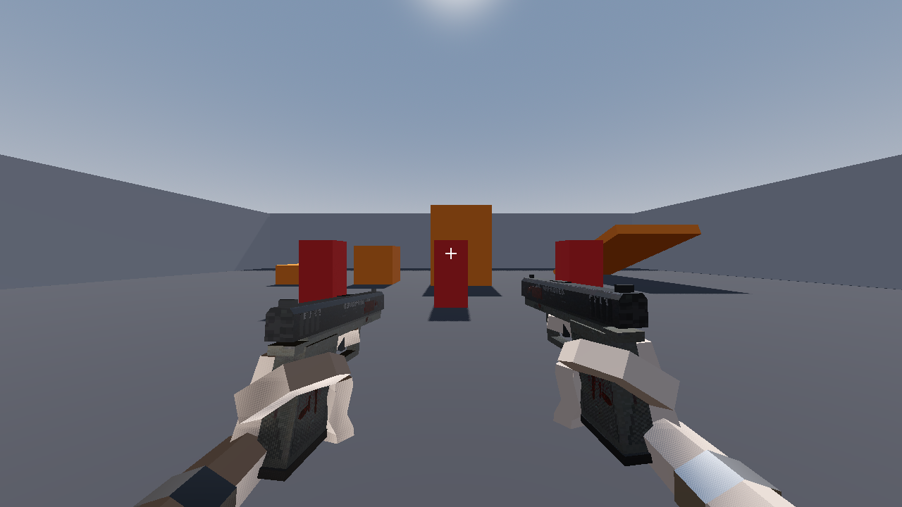

# DeltaFosB

A fast-paced first-person shooter made in **Godot 4.7**, with a low-poly **PS1-style** look and a dark,
bloody parody of office life. Office equipment turns into weapons: a pencil, a pistol tagged by HR,
a Mossberg-style pump shotgun and a minigun built into a beige PC tower.

## Features

- Movement: run, jump, slide, dash, slam and wall jump
- Weapons with first-person arms: pencil (melee), pistol, pump shotgun, minigun
- Dual wielding (test option in the pause menu's Settings)
- Weapon switch animation, recoil, per-weapon crosshairs, and a sideways "gangster grip" on the pistol while sliding

## Running it

Open the project folder in Godot 4.7 and press Play (the test level is `scenes/levels/test_level.tscn`).
